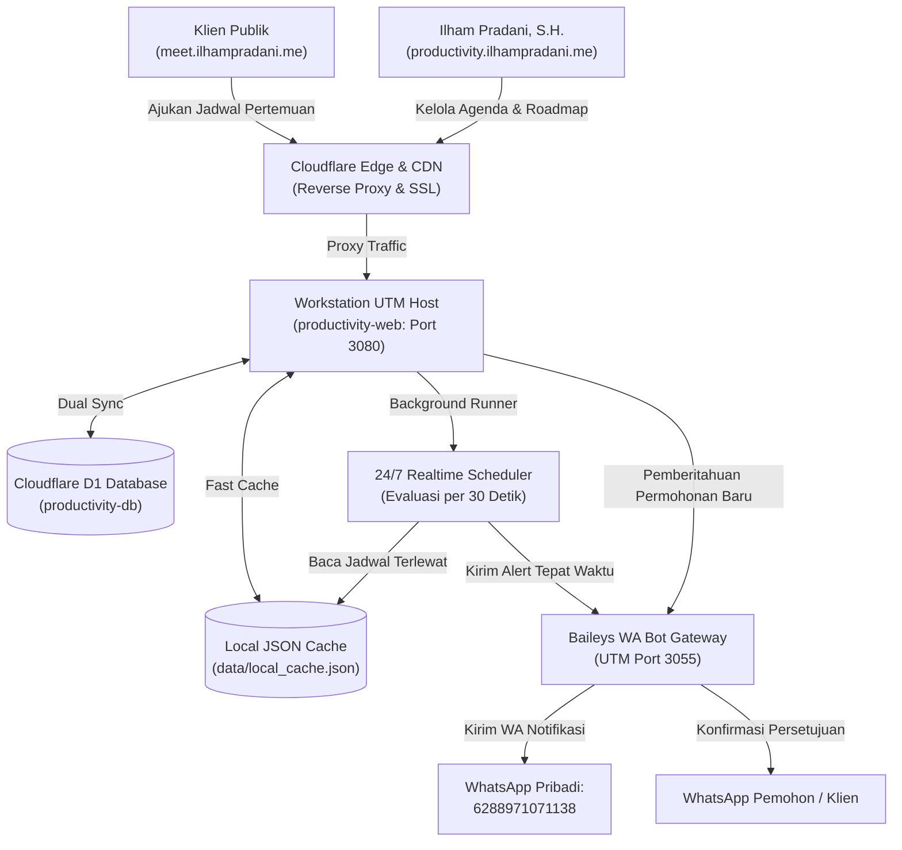

# ⭐ Aura Executive Desk • Minimalist Productivity Suite ⭐

<p align="center">
  
</p>

<p align="center">
  <b>Sistem Manajemen Produktivitas Eksekutif, Penjadwalan 24 Jam Bebas Bentrok, dan Portal Konsultasi Hukum Publik</b><br>
  <i>Dirancang khusus untuk <b>Ilham Pradani, S.H.</b> dengan Integrasi Cloudflare D1 & Bot Notifikasi WhatsApp Real-Time 24/7</i>
</p>

<p align="center">
  <a href="https://github.com/ilhampradani8-bot/productivity/stargazers"></a>
  
  
  
  
</p>

---

## 🌐 Layanan & Portal Resmi

1. **Executive Dashboard Desk**: [https://productivity.ilhampradani.me/](https://productivity.ilhampradani.me/)
   - Pusat kendali agenda harian, alokasi blok waktu 24 jam, evaluasi kendala, dan roadmap bulanan. Dilengkapi PIN Lock Gate.
2. **Public Meeting & Consultation Portal**: [https://meet.ilhampradani.me/](https://meet.ilhampradani.me/)
   - Portal pengajuan jadwal konsultasi hukum dan pertemuan resmi klien dengan deteksi slot kosong otomatis dan verifikasi WhatsApp instan.

---

## 🌟 Fitur Utama & Keunggulan Arsitektur

- **Roadmap Bulanan & Alokasi Waktu 24 Jam**:
  - Tampilan kartu harian interaktif (*Day Cards 1 s/d 30/31*) dengan nomor rasio jam teralokasi presisi: **`2/24 Jam`**, **`14/24 Jam`**, dll.
  - Perhitungan otomatis rata-rata jam kerja per hari dalam sebulan, total kapasitas jam terpakai, dan deteksi hari terpadat.
  - Mini visual progress bar berwarna adaptif (*Emerald, Indigo, Amber, Rose*) untuk melihat kepadatan hari dalam sekejap.
  - Navigasi bulan fleksibel (*Bulan Sebelumnya, Bulan Ini, Bulan Berikutnya*).
- **24/7 Autonomous Server Scheduler (Real-Time WhatsApp Alert)**:
  - Background daemon berjalan 24 jam nonstop via systemd service `productivity-web.service` di workstation UTM (`Node.js Port 3080`).
  - Memeriksa jadwal aktif setiap 30 detik.
  - **Tepat 15 menit** setelah suatu agenda berakhir, server langsung mengirimkan pengingat WhatsApp secara otomatis tanpa perlu membuka aplikasi web.
- **Mode Penjadwalan Dinamis (Anti-Bentrok)**:
  - **Sekali Saja (Hanya Tanggal Ini)**: Pilihan tanggal eksekusi tunggal dengan tombol preset cepat (*Hari Ini, Besok, Senin Depan, Minggu Depan*). Bagian perulangan dan masa berlaku otomatis disembunyikan total.
  - **Rutinitas Berulang (Tiap Hari/Rutin)**: Menampilkan frekuensi perulangan (*Setiap Hari, Hari Kerja, Mingguan, Tahunan*) dan batas masa berlaku, dengan tombol preset tanggal tunggal otomatis di-hide.
- **Radial Analog 24-Jam Visual Clock Picker**:
  - Pemilih waktu visual interaktif jam bulat analog dengan dukungan 2 sesi waktu kerja (Sesi Siang & Sesi Malam) untuk alokasi kerja eksekutif yang presisi.
- **Deteksi Bentrok Jadwal Real-Time**:
  - Alokasi waktu bersih 24 jam dengan visualisasi timeline bebas bentrok yang dapat diklik langsung untuk memilih slot jam kosong berikutnya.
- **Evaluasi Tugas Terlewat & Penjadwalan Ulang**:
  - Tugas yang belum dicoret tidak dapat diabaikan begitu saja; sistem mewajibkan pengisian catatan kendala atau alasan mengapa tugas tertunda untuk evaluasi diri dan dapat dijadwalkan ulang ke esok hari dengan satu sentuhan.
- **Persistensi Database Ganda (Cloudflare D1 & Local Cache)**:
  - Sinkronisasi dua arah instan antara Browser, Local Cache Server UTM (`data/local_cache.json`), dan Cloudflare D1 SQL Edge (`productivity-db`).
- **Mobile-First Responsive & 100% SVG Vector**:
  - Antarmuka putih klasik (*classic white minimalism*), sepenuhnya responsif di semua ukuran layar ponsel/tablet, bebas overflow horizontal, serta menggunakan ikon SVG tajam tanpa ketergantungan emoji teks.
- **Optimasi Penuh SEO Google Indexation**:
  - Dilengkapi metadata komprehensif, Schema.org JSON-LD `LegalService`, `robots.txt`, dan `sitemap.xml` untuk keterindeksan optimal di Google Search.

---

## 🏛️ Arsitektur Sistem



---

## 🗄️ Skema Database (Cloudflare D1)

Skema database lengkap didefinisikan dalam [`schema.sql`](./schema.sql):

- `tasks`: Menyimpan agenda kerja harian, rentang waktu, tanggal target, frekuensi perulangan, status, dan riwayat evaluasi.
- `settings`: Menyimpan preferensi pengguna dan konfigurasi jadwal pengingat notifikasi.
- `activity_logs`: Mencatat riwayat pengiriman notifikasi dan audit trail sistem.
- `notification_queue`: Antrean pesan WhatsApp yang diteruskan ke node lokal UTM.
- `meeting_requests`: Menyimpan permohonan pertemuan dan konsultasi dari portal publik.

---

## 🚀 Menjalankan & Mengembangkan

### Di Lingkungan Workstation UTM (Ubuntu / Node.js)
```bash
cd /root/productivity
npm install
node server.js
```
Layanan dikelola secara otomatis oleh systemd:
```bash
systemctl status productivity-web
systemctl restart productivity-web
journalctl -u productivity-web -f
```

### Sinkronisasi Git (Dual-Push)
```bash
git add .
git commit -m "feat: pembaruan sistem"
git push origin master
```

---

## 📄 Lisensi

Hak Cipta © 2026 **Ilham Pradani, S.H.** Seluruh hak dilindungi undang-undang. Lisensi di bawah [MIT License](./LICENSE).
