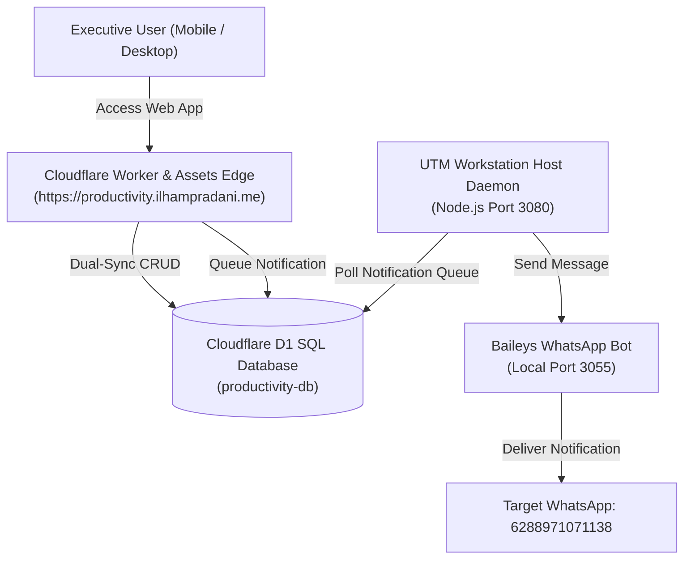

# ⭐ Aura Executive Desk • Minimalist Productivity Suite ⭐

<p align="center">
  
</p>

<p align="center">
  <b>Clean, Clash-Free Executive Productivity Desk with Cloudflare D1 Persistence & WhatsApp Alerts</b>
</p>

<p align="center">
  <a href="https://github.com/ilhampradani8-bot/productivity/stargazers"></a>
  
  
  
  
</p>

<p align="center">
  ✨ <b>Show your support: If you find this productivity suite useful, please give it a Star!</b> ⭐ ✨
</p>

---

## 🌟 Key Highlights

- **Form Agenda Gaya Google**: Tambah agenda harian dengan pemilihan tanggal fleksibel (hari ini, besok, senin depan), perulangan harian berjangka (1-3 tahun), serta rekomendasi judul otomatis (*smart title autocomplete*).
- **Radial Analog 24-Jam Visual Clock Picker**: Pemilih waktu visual interaktif dengan jam bulat analog, pemisahan sesi siang dan sesi malam untuk alokasi kerja yang presisi.
- **Deteksi Bentrok Jadwal Real-Time**: Alokasi waktu bersih 24 jam dengan visualisasi *clash-free timeline* yang dapat diklik langsung untuk memilih slot jam kosong.
- **Evaluasi Tugas Terlewat (Missed Task Reason)**: Tugas yang belum terselesaikan tidak dapat diabaikan begitu saja; sistem mewajibkan pengisian catatan kendala atau alasan mengapa tugas tertunda untuk evaluasi diri.
- **Cloudflare Edge D1 Persistent Database**: Seluruh agenda, konfigurasi notifikasi, dan riwayat disimpan permanen di Cloudflare D1 SQL Edge (`productivity-db`), memastikan data tidak akan pernah hilang.
- **WhatsApp Notification Bridge**: Notifikasi harian, briefing pagi, rekap malam, dan peringatan tugas terlewat dikirim secara terarah ke nomor WhatsApp target tanpa mengganggu sesi bot lainnya.
- **Mobile-First Responsive & 100% SVG Vector**: Tampilan putih klasik (*classic white minimalism*), sepenuhnya ramah layar ponsel, tanpa penggunaan emoji berbasis teks agar tetap tajam dan profesional.

---

## 🏛️ System Architecture



---

## 🗄️ Database Schema (Cloudflare D1)

The complete SQL schema is defined in [`schema.sql`](./schema.sql):

- `tasks`: Menyimpan agenda kerja, rentang waktu, tanggal target, perulangan, status, dan riwayat evaluasi.
- `settings`: Menyimpan preferensi pengguna dan konfigurasi notifikasi.
- `activity_logs`: Mencatat riwayat pengiriman notifikasi dan audit trail.
- `notification_queue`: Antrean pesan WhatsApp yang diteruskan ke node lokal.

---

## 🚀 Running & Developing

### Local Development
```bash
git clone https://github.com/ilhampradani8-bot/productivity.git
cd productivity
npm install
node server.js
```
Akses web di `http://localhost:3080`.

### Cloudflare Deployment
```bash
npx wrangler deploy
```

---

## 📄 License

This project is licensed under the [MIT License](./LICENSE).
